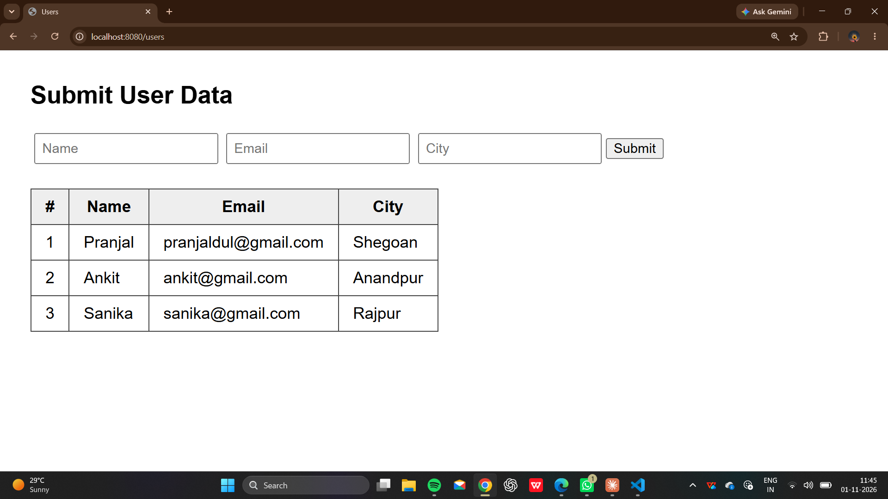
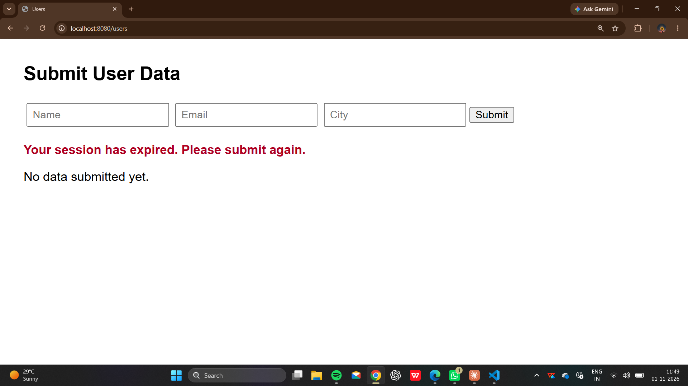

# Session Table Servlet (Maven + Embedded Jetty)

A servlet that stores each submitted user record in an HttpSession list and renders all submissions as an HTML table.

## Features
- Form submission handled with POST
- Records stored in a session-scoped list
- HTML table generated by the servlet
- Graceful handling of session expiry (60 seconds timeout)
- Post/Redirect/Get to avoid duplicate submissions

## Tech Stack
Java 17, Maven, Jakarta Servlet API 5.0, Embedded Jetty 11

## How to Run
mvn compile exec:java

Then open http://localhost:8080/users

## Project Structure
session-table-servlet/
- pom.xml
- src/main/java/com/example/App.java
- src/main/java/com/example/UserTableServlet.java

## Screenshots

## Author
Pranjal Dulhani
